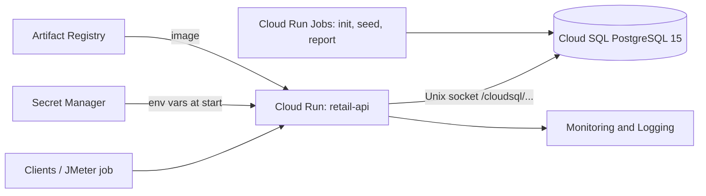
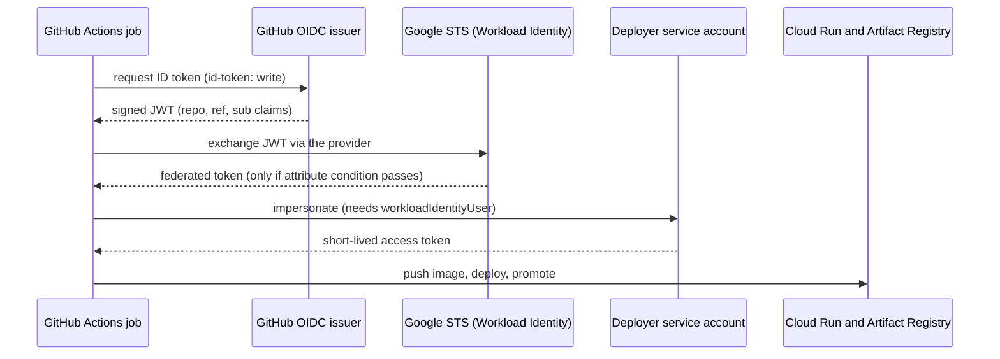

# Explanation: how the project works and why, for interviews

This document explains the Retail API on Google Cloud well enough to answer follow-up questions on any part of it: what each piece does, why it was chosen, what the alternatives were, what was measured, what broke, and what the limits are. Numbers come from [RESULTS.md](RESULTS.md); the phase-by-phase history is in [IMPLEMENTATION_PLAN.md](IMPLEMENTATION_PLAN.md).

## Contents

1. [The 30-second and 2-minute pitch](#1-the-30-second-and-2-minute-pitch)
2. [What the application does](#2-what-the-application-does)
3. [Architecture and why each piece is used](#3-architecture-and-why-each-piece-is-used)
4. [How a purchase works, and why it cannot oversell](#4-how-a-purchase-works-and-why-it-cannot-oversell)
5. [Connection pooling and the 25-connection limit](#5-connection-pooling-and-the-25-connection-limit)
6. [Cloud Run concepts used](#6-cloud-run-concepts-used)
7. [Security and identity](#7-security-and-identity)
8. [CI/CD and Workload Identity Federation](#8-cicd-and-workload-identity-federation)
9. [Observability](#9-observability)
10. [Load testing: method, results, and how to read them](#10-load-testing-method-results-and-how-to-read-them)
11. [Things that broke and what they taught](#11-things-that-broke-and-what-they-taught)
12. [Cost and cleanup](#12-cost-and-cleanup)
13. [Limitations and what I would do next](#13-limitations-and-what-i-would-do-next)
14. [Interview question bank with answers](#14-interview-question-bank-with-answers)
15. [Numbers cheat sheet](#15-numbers-cheat-sheet)
16. [Being straight about how it was built](#16-being-straight-about-how-it-was-built)
17. [Glossary](#17-glossary)

---

## 1. The 30-second and 2-minute pitch

**30 seconds.** "I took a FastAPI and PostgreSQL retail API that I had run on Kubernetes and moved it to Google Cloud Run with Cloud SQL. Images are built and tagged by commit, credentials are in Secret Manager, and a GitHub Actions pipeline deploys through Workload Identity Federation, so there are no stored keys. I load tested it from inside the region and found two things: every request updating one row caps throughput around 100 requests a second, and Cloud SQL's small tier allows only 25 connections, so the connection pools have to be sized to that. I also broke it on purpose to see the failure and confirm the alert fires."

**2 minutes.** Add: the purchase endpoint is one atomic `UPDATE ... WHERE stock > 0 RETURNING` plus an order row in the same transaction, and I verified across 34,296 purchases that orders equal stock removed, so there was no overselling. Spreading the same load over four items took it from 106 to 276 requests a second with a median latency of 260 ms instead of 955 ms. The pool math is instances x workers x (pool + overflow) must stay under `max_connections` minus the reserved slots; the deployed setting is 3 x 2 x 3 = 18 against 22 usable. When I tried 10 + 10 per worker, only 22.6% of requests succeeded and Postgres answered "remaining connection slots are reserved". Monitoring is a dashboard, an uptime check and three alerts, all defined as JSON; the 5xx alert fired and recovered during that test. I also hit and fixed real problems: a Google front-end quirk that makes `/healthz` unusable, a SQLAlchemy 2.1 driver default that broke fresh builds, and a startup race between workers.

## 2. What the application does

- **Customer side:** `GET /` serves a storefront page, `GET /items` lists items, `POST /purchase/{id}` buys one unit.
- **Admin side:** JWT login at `/admin/login`, then add, edit (price, restock) and delete items.
- **Health:** `/livez` returns immediately and never touches the database; `/health` runs `SELECT 1` and returns 503 if the database is unreachable.
- **Data:** `items`, `admins`, and `orders` (one row per successful purchase: id, item id, timestamp).
- **Layout (MVC):** `app/controllers` (routes), `app/models` (SQLAlchemy tables), `app/services` (auth), `app/views` (Jinja templates), `app/core/database.py` (engine and pool).

The app is deliberately small. The project is about running it well in the cloud, not about the business logic.

## 3. Architecture and why each piece is used



| Piece | What it does here | Why this and not the alternative |
|---|---|---|
| **Cloud Run** | Runs the container, scales instances by request load, splits traffic between revisions | The API is stateless, so a managed platform removes cluster operations. Alternatives: GKE (full Kubernetes control but you manage nodes, upgrades and cost), Compute Engine VMs (manual scaling, patching), App Engine (similar, less container-native). Cloud Run also gives revisions, tagged URLs and traffic splitting for free. |
| **Cloud SQL for PostgreSQL** | Managed Postgres | The app already used Postgres and SQL features (`RETURNING`, row locks). Managed means backups, patching and the connector are handled. Alternatives: Cloud SQL for MySQL (would need code changes), AlloyDB (much more expensive), self-hosted Postgres on a VM (more work), Firestore (different data model, no transactions like this one). |
| **`db-f1-micro` tier** | Smallest shared-core instance, 0.6 GB memory | Cheapest for a short test. The cost is the 25-connection limit and CPU limits. A larger tier raises `max_connections` and removes the CPU ceiling. |
| **Artifact Registry** | Stores the Docker images | The current Google-recommended registry (Container Registry is deprecated). Supports cleanup policies. |
| **Image tags = git SHA** | Each revision maps to one commit | Mutable tags like `latest` make rollbacks and audits ambiguous. |
| **Secret Manager** | Database password, JWT key, admin password | Keeps secrets out of the repo, image and plain environment configuration. Access is per secret through IAM and audited. Alternatives: Kubernetes secrets (base64, weaker), env vars in the deploy command (visible in config history). |
| **Workload Identity Federation** | Lets GitHub Actions authenticate without a stored key | A service account JSON key is a long-lived credential that can leak. WIF exchanges a short-lived token. |
| **Cloud Run Jobs** | Runs schema creation, seeding, the consistency report and the load generator from the same image | One-off tasks that need DB access should not run inside the web service and should not need a bastion host or an open database port. |
| **Cloud Monitoring and Logging** | Dashboard, alerts, uptime check, log-based metric | Built in, no agents to run. |
| **GitHub Actions** | CI/CD | The repo was already on GitHub; hosted runners need no infrastructure. |

**Why Cloud Run over the original Kubernetes setup.** The Minikube version used 3 replicas and an Nginx Ingress, which is a good way to learn Kubernetes but means running and upgrading a cluster. For one stateless API, Cloud Run gives rolling revisions, health-gated releases and autoscaling with much less to maintain. Trade-offs: less control over networking and scheduling, cold starts (measured at 6.1 to 6.4 s here), and platform limits such as 8 tags per service.

## 4. How a purchase works, and why it cannot oversell

The core statement, in one transaction:

```sql
UPDATE items SET stock = stock - 1 WHERE id = :id AND stock > 0 RETURNING id;
INSERT INTO orders (item_id) VALUES (:id);   -- same transaction
COMMIT;
```

If the `UPDATE` returns no row (stock was 0 or the item does not exist), the API returns HTTP 409.

**Why it is safe under concurrency.** In PostgreSQL's default READ COMMITTED isolation, an `UPDATE` takes a row-level lock held until the transaction ends. If another transaction tries to update the same row, it waits. When the first commits, the second re-checks the `WHERE stock > 0` condition against the new row version. So if the last unit was just sold, the second update matches nothing. The check and the decrement happen in one statement, so there is no gap between "read the stock" and "write the stock" for another request to slip into. A naive version (`SELECT stock`, check in Python, `UPDATE`) would oversell.

**Why the order insert is in the same transaction.** The decrement and the order row either both commit or both roll back. That is why, after 34,296 purchases, the number of order rows equals the stock removed on every item.

**Alternatives and why not.** `SELECT ... FOR UPDATE` then update (two round trips, longer lock). Optimistic locking with a version column (retries under contention). A queue plus a single consumer (more infrastructure). The single guarded `UPDATE` is the simplest correct option.

**The cost.** The row lock is held from the `UPDATE` until `COMMIT`, which also covers the `INSERT` and the commit itself. That is the mechanism behind the hot-row ceiling in section 10.

## 5. Connection pooling and the 25-connection limit

**What a pool is.** Opening a Postgres connection is expensive, so the app keeps a few open and lends them to requests. SQLAlchemy's `QueuePool` holds `pool_size` persistent connections and allows `max_overflow` extra temporary ones. If none is free, a request waits up to `pool_timeout` (30 s) and then fails. The pool belongs to one process, so each Uvicorn worker has its own.

**The budget formula.**

```
max_instances x workers x (pool_size + max_overflow)  <=  max_connections - reserved
        3       x    2    x        (2 + 1)             =  18   <=   25 - 3 = 22
```

- `max_connections` was measured with `SHOW max_connections;` through a Cloud Run Job: **25**, with 3 reserved for superusers.
- The original code used `pool_size=20, max_overflow=30` per worker (up to 50 connections each). That works on the old Postgres with `max_connections=350` but would exhaust this database with a single instance.
- The pool size is now read from `DB_POOL_SIZE` and `DB_MAX_OVERFLOW`, so it can be tuned without a code change.

**What happens when the budget is exceeded.** I tested it on purpose with 10 + 10 per worker (up to 120 connections). Only 452 of 2,000 requests succeeded (22.6%). The database answered `FATAL: remaining connection slots are reserved for non-replication superuser` and `FATAL: sorry, too many clients already`; the app surfaced these as HTTP 500. The median latency stayed low (246 ms) while p95 reached about 21 seconds, because the requests that got a connection were fast and the rest waited or failed. That is why alerts use error rate and percentiles, not the average.

**Why not just raise the limit.** A bigger instance raises `max_connections`, at a cost. A connection pooler such as PgBouncer would let many app connections share a few database connections; that is the next step in the "what I would do" list. (Cloud SQL also offers managed connection pooling on some editions; I did not check whether it applies to this tier, so I do not claim it.)

**Why a small pool can still serve 40 concurrent requests.** The endpoints are synchronous functions, which FastAPI runs in a thread pool. A request holds a connection only while it runs its transaction, so a pool of 3 per worker can serve more requests than 3 by turning them over quickly; the others queue for a connection. This is reasoning about the design, and the measured result is that the setup completed 5,000 requests with zero errors.

## 6. Cloud Run concepts used

- **Revision.** Every deploy creates an immutable revision. Traffic is assigned to revisions by percentage.
- **Tagged URL.** A revision can be given a tag and reached at `https://<tag>---<service>-<hash>.a.run.app` while receiving 0% of public traffic. The pipeline deploys with `--no-traffic --tag candidate`, smoke tests that URL, then promotes. A service allows at most 8 tags (I hit this in testing).
- **Traffic split and rollback.** I practiced a 10% split, promotion, rollback to an older revision and roll forward.
- **Concurrency (40).** How many requests one instance handles at the same time. With 2 vCPU and a synchronous app, 40 is a reasonable start; it also determines how fast Cloud Run adds instances.
- **Autoscaling.** Instances scale between min and max based on load. Max was 3 (to respect the connection budget); min was 1 during testing and 0 at the end to save cost. During the failure test the instance count reached 6 briefly because old and new revisions were both running during the rollout.
- **Cold start.** With min instances 0, the first request after idle starts a container. Measured 6.1 to 6.4 seconds (laptop to Mumbai, includes the DB readiness check) versus 0.2 to 0.3 seconds warm. A 2-second startup probe period gave 5.4 seconds in one sample, which is not a confirmed improvement. CPU boost speeds startup.
- **Probes.** Cloud Run supports a **startup probe** (traffic is not sent until it passes) and a **liveness probe** (restart if it keeps failing). It has no separate readiness probe like Kubernetes. Here the startup probe hits `/health` (which checks the database) and the liveness probe hits `/livez` (which does not).
- **Why liveness must not check the database.** If liveness depended on the database, a database outage would make Cloud Run restart perfectly healthy containers, making things worse.
- **`/healthz` is unusable.** Cloud Run's front end reserves `/healthz` on public `*.run.app` URLs and returns its own 404, so the route is `/livez`.
- **`PORT`.** Cloud Run tells the container which port to listen on through the `PORT` variable; the Dockerfile reads it (default 8000) and runs Uvicorn with `exec` so the process receives shutdown signals.
- **Billing.** The service used request-based billing (CPU is charged while handling requests); an always-on `min-instances` also costs while idle.
- **Jobs.** Same image, run to completion once: `init_db`, `create_admin`, `seed_items`, `db_report`, and the JMeter load generator.

## 7. Security and identity

**Two service accounts, least privilege.**

| Account | Used by | Permissions |
|---|---|---|
| `retail-run-sa` | The running service and jobs | Cloud SQL Client (project level) and Secret Accessor on the three secrets only |
| `retail-deployer-sa` | GitHub Actions | Cloud Run Admin on the one service, Artifact Registry Writer on the one repo, Service Account User on `retail-run-sa` only. No project-level roles, no keys |

**Why separate accounts.** The identity that runs the app should not be able to deploy, and the identity that deploys should not be able to read the database password.

**Secrets.** The database password, JWT key and admin password were generated randomly and stored in Secret Manager, never printed or committed. Cloud Run injects them as environment variables when an instance starts. The app refuses to start in production without `SECRET_KEY`. Note that `:latest` resolves when an instance starts, so rotating a secret needs a new revision or instance to take effect.

**Database access.** The instance has the default public IP but **no authorized networks**. Cloud Run connects through the built-in Cloud SQL connector (a Unix socket at `/cloudsql/<connection name>`), which authenticates the caller with IAM and encrypts the connection. The database user and password are still used inside that tunnel. Private IP (with a VPC connector or Direct VPC egress) would be stronger and was not set up.

**Application security.** Admin routes require a JWT (HS256, 30-minute expiry) signed with the secret key; passwords are hashed with bcrypt. The old hardcoded secret and the `admin123` default were removed, and the old password is rejected (HTTP 401, verified).

**Known weak spots.** The service is public (`allow-unauthenticated`, since it is a storefront); there is no rate limiting or WAF (Cloud Armor was not added); HS256 uses a shared secret; no refresh tokens or token revocation; the database user is a single app user with full rights on its database.

## 8. CI/CD and Workload Identity Federation

**Pipeline** (`.github/workflows/gcp-deploy.yml`), on push to `gcp`: run unit tests, build the image tagged with the commit SHA, authenticate to Google Cloud, push the image (with retries), deploy a revision with no traffic on a `candidate` tag, smoke test it (`/livez`, `/health`, `/items`), then promote it to 100%. Pushes that only change docs, screenshots or monitoring files are ignored.



**Why this is safer than a key.** A service account key is a file that stays valid until someone revokes it, so a leaked repo secret is a standing breach. With Workload Identity Federation, each job gets a token that expires in minutes, and Google only issues it if the token's claims match.

**What restricts it.** The provider has an attribute condition: `assertion.repository=='RO-03/Retail-API-GCP' && assertion.ref in ['refs/heads/gcp','refs/heads/main']`. A workflow from another repository, or from a different branch, is rejected. The service account also only trusts principals whose `repository` attribute equals this repo.

**What went wrong.** The first run failed because `pytest` was not run as a module, so the app package was not importable. A later run failed at `docker push` with "Unable to retrieve Identity Pool subject token (connection timeout)", a transient failure after a long idle build. The fix was to build before authenticating and to retry the push up to 3 times. 2 of the first 6 runs failed for those two reasons; every later run passed.

**Why there is no performance gate in CI.** The same test gave 35 and 104 requests per second on two runs, so a throughput threshold would fail randomly. The original Minikube pipeline had one (80 RPS floor); I chose not to copy it without understanding the variance first.

**Release safety.** The candidate revision is verified on its own URL before it takes traffic, and the previous revision stays available for instant rollback.

## 9. Observability

- **Dashboard** (6 charts): requests per second by status class (2xx, 4xx, 5xx), latency p50, p95 and p99, instance count, Cloud SQL connections (limit 25), Cloud SQL CPU, and out-of-stock (HTTP 409) responses per minute.
- **Uptime check:** HTTPS GET `/livez` every minute from multiple Google locations (6 reported). It kept an instance warm, which is also why cold-start tests used old revisions.
- **Alert policies:** more than 5 server errors in 5 minutes; p95 latency above 2 seconds for 5 minutes; uptime check failing from more than one location. All email the owner.
- **Log-based metric `out_of_stock_409`:** counts 409 responses from the request log, so a business event (sold out) is visible as a metric without code changes. Verified with 8 deliberate requests.
- **Verified end to end:** the 5xx alert fired at 12:15 AM during the pool test and recovered at 12:26 AM, and the email arrived.
- **As code:** the dashboard and alert definitions are JSON in `monitoring/`, applied through the Monitoring API. That is monitoring as code, not Terraform.

**The four golden signals mapped:** latency (percentile chart), traffic (requests per second), errors (5xx and 4xx classes), saturation (instance count, Cloud SQL connections and CPU).

**Why percentiles.** An average hides a tail. In the pool test the median was 246 ms while p95 was about 21 s and 77% of requests failed.

## 10. Load testing: method, results, and how to read them

**Tool and setup.** Apache JMeter with `batches.jmx`, parameterized by `host`, `port`, `protocol`, `items`, `threads`, `loops` and `ramp`. 200 concurrent users, a synchronizing timer that releases all users together (group size 0 means "all active threads", so changing the thread count cannot hang the test), POST `/purchase/{id}`. The load generator ran as a Cloud Run Job in the same region (a JMeter container image in `loadtest/`) so the laptop's internet did not distort results. The job computes the summary inside the container (`sort` and `awk`), because Cloud Logging dropped lines when 5,000 raw CSV rows were logged.

**Results (5,000 requests each, all HTTP 200, zero errors, in-region):**

| Scenario | Throughput | p50 | p95 | p99 |
|---|---|---|---|---|
| Every request on item 1 (hot row) | 106.5 req/s | 955 ms | 1,785 ms | 3,455 ms |
| Requests spread over 4 items | 276.3 req/s | 260 ms | 524 ms | 4,892 ms |

**How to explain the difference.** Same service, same database, same load; only the target row changed. Updates to one row run one at a time because of the row lock, so throughput is bounded by how long each transaction holds it. Spread over four rows, four transactions can progress in parallel. That is consistent with row-lock contention. I did not inspect lock waits in Postgres (for example `pg_locks`), so it is strong evidence, not proof. The p99 did not improve (3 to 5 seconds in most runs) and its cause is undiagnosed; candidates are pool queueing, instance start-up and the shared CPU of `db-f1-micro`.

**Laptop versus in-region.** The first runs were from the laptop. In-region numbers were not better at the median, which showed the limit was the server side, not the internet.

**Variance.** The identical 1,000-request test gave 35 req/s (first run after idle, instances still scaling from 1 to 3) and 104 req/s on repeat. Short bursts are dominated by tail requests, so I used 5,000-request sustained runs for the numbers I quote.

**A mistake I caught.** Two early 5,000-request runs ran out of stock partway, so many responses were HTTP 409 (a cheaper path than a purchase). They are kept in the log but labeled not comparable, and the clean runs were repeated after topping up stock.

**What I did not measure.** A Minikube versus Cloud Run comparison with the same test. The old repo's CI comment says about 120 RPS, and the resume says 270+; none of that was re-measured here, so no comparison is claimed.

**Consistency check.** After the runs: item 1 (21,221 orders, stock removed 21,221), item 2 (4,415 and 4,415), item 3 (4,318 and 4,318), item 4 (4,342 and 4,342); 34,296 orders in total.

## 11. Things that broke and what they taught

| Problem | Root cause | Fix | Lesson |
|---|---|---|---|
| Fresh Docker build failed, `No module named 'psycopg'` | SQLAlchemy 2.1 maps `postgresql://` to psycopg v3; project installs psycopg2; dependencies unpinned | Rewrite the URL to `postgresql+psycopg2://`, pin versions | Pin dependencies; an old working image can hide a broken build |
| One worker crashed at startup with a duplicate-key error | Both workers ran `create_all` at import time and raced | A separate init script run once as a Job | Do not do schema changes at import time in a multi-process app |
| Pool plan (3 x 2 x 5 = 30) could not work | Measured `max_connections` was 25 | Pools of 2 + 1, total 18 | Measure limits instead of assuming them |
| `/healthz` returned a Google 404 | Cloud Run's front end reserves it | Renamed to `/livez` | Platforms reserve paths; test probes on the real URL |
| Throughput stuck near 100 req/s | Hot-row lock contention | Spread test confirmed (276 req/s) | Concurrency problems can live in the data, not the compute |
| Comparison runs gave odd numbers | Stock ran out mid-run, so 409s mixed with 200s | Top up stock, repeat, label the mixed runs | Check the response-code mix before trusting a number |
| JMeter results lost lines in Cloud Logging | Logging drops lines under bursts | Summarize inside the container | Do not ship bulk data through logs |
| Docker push failed with an identity-token timeout | Transient token fetch after a long idle build | Build first, authenticate late, retry push | Make short-lived-credential steps resilient |
| Uptime check could not be deleted | An alert policy still referenced it | Delete the policy first (its JSON is saved) | Dependencies matter when tearing down |
| A cold-start control test returned 404 | Cloud Run allows only 8 tags per service | Removed old tags | Know platform quotas |

## 12. Cost and cleanup

- **Main cost:** Cloud SQL, because it bills while it exists. It was created for the testing window only.
- **Others:** Cloud Run (request-based, small), Cloud Build (free monthly allowance), Artifact Registry (small storage), Secret Manager and Monitoring (free at this scale).
- **Controls:** a monthly budget of INR 2,420 with alerts at 25%, 50% and 100% (about USD 7, 14 and 28). Budget alerts only notify and do not stop spending, so the real control is deleting the expensive resources.
- **Teardown (done 2026-10-13):** deleted Cloud SQL, the Cloud Run service and jobs, the uptime check and its alert policy; disabled the deploy workflow; verified there were no remaining billable resources. Kept: images, secrets, the Workload Identity pool and the monitoring JSON.
- **Final cost:** not known yet because billing data lags; the trial credit applies first.

## 13. Limitations and what I would do next

**Limitations (say these before they are asked):**
- Single region, single zone database, no backups, no read replica, so no high availability and no disaster recovery.
- Smallest database tier; its 25-connection limit shaped the design and its shared CPU limits throughput.
- Public IP on the database (no authorized networks, connector-only), not private IP.
- Variance between runs is large; most experiments ran once per configuration.
- Unit tests use SQLite, which does not reproduce Postgres locking, so concurrency was verified manually against Postgres and by load tests.
- No rate limiting or WAF; HS256 JWTs.
- The p99 tail and the 429 responses in the failure test were not diagnosed.
- No live environment now, and no Minikube comparison.

**Next steps, in priority order:**
1. A connection pooler (for example PgBouncer) so app instances do not each hold database connections.
2. Private IP for Cloud SQL with Direct VPC egress, removing the public IP.
3. Inspect lock waits (`pg_locks`, `pg_stat_activity`) to confirm the row-lock explanation, and try a single-statement CTE (`WITH purchased AS (UPDATE ... RETURNING id) INSERT ... SELECT`) to shorten the lock hold by one round trip.
4. A larger tier and a backup plan, then load test at higher concurrency.
5. Terraform for the whole environment, so it can be recreated with one command.
6. Cloud Armor rate limiting, and a pipeline performance check once variance is understood.
7. Cloud Trace (OpenTelemetry) to see where the p99 tail comes from.

## 14. Interview question bank with answers

**Project and decisions**

*Why did you move this to GCP?* To learn managed cloud services on a project I already understood, and to replace cluster operations with a managed platform for a stateless API.

*Why Cloud Run and not GKE?* Stateless service, no need for Kubernetes features, far less to operate, revisions and traffic splitting built in. GKE would make sense for many interdependent services, special networking or scheduling needs.

*Why Cloud SQL and not AlloyDB or Firestore?* The app uses SQL transactions and `RETURNING`; Cloud SQL Postgres is the closest managed fit and cheapest. AlloyDB costs far more; Firestore has a different transaction model.

*What was the hardest part?* Reasoning about the database limits: measuring `max_connections` (25), sizing pools to it, and then proving it by breaking it on purpose.

*What would you change if this were production?* High availability (regional instance), backups, private IP, a connection pooler, rate limiting, secrets rotation, Terraform, and alert routing beyond email.

**Concurrency and database**

*How do you prevent overselling?* A single `UPDATE ... WHERE stock > 0 RETURNING` that checks and decrements atomically, under READ COMMITTED row locking; plus the order insert in the same transaction. Verified with 34,296 purchases.

*Why is throughput lower with one item?* Row-lock contention: updates to the same row are serialized, so the lock hold time sets the ceiling. Spreading over four items gave 2.6x throughput and 3.7x lower median latency.

*Could you make the hot row faster?* Shorten the transaction (one statement with a CTE), reduce round trips, make commits cheaper with a larger instance, or avoid contention by sharding stock across rows or using a reservation queue.

*What is the difference between a connection pool per instance and per worker?* Each Uvicorn worker is a separate process with its own pool, so the total is instances x workers x (pool + overflow).

*What error did you see when connections ran out, and how does it show up?* `FATAL: remaining connection slots are reserved for non-replication superuser` and `too many clients already`; HTTP 500s, rising p95, and a flat low median. The 5xx alert fired.

*Why did you read `max_connections` instead of using the default?* Cloud SQL sets it by tier; the small shared-core tier gave 25. The plan's first example would have exceeded it.

**Cloud Run**

*What is concurrency and how did you choose 40?* Simultaneous requests per instance. A synchronous app on 2 vCPU can interleave many requests that are mostly waiting on the database; 40 was a starting value, not tuned, and the connection budget (not concurrency) was the binding limit.

*What happens on a cold start?* A new container starts, the app imports, two workers start, and the startup probe `/health` must pass before traffic arrives. Measured 6.1 to 6.4 s versus 0.2 to 0.3 s warm.

*How would you reduce cold start?* Minimum instances of 1 (costs money), a smaller image, lazier imports, fewer workers, CPU boost (already on). I tested a shorter probe period and saw only about a second, from one sample.

*How do rollbacks work?* Revisions are immutable; traffic can be pointed back at an older revision in seconds. I rolled back and forward during practice.

*What is a tagged URL for?* To test a new revision with real infrastructure before it receives any user traffic. The pipeline does this with the `candidate` tag.

*Why `/livez` and `/health`?* Liveness must not depend on the database (otherwise a DB outage restarts healthy containers); the startup check should include the database so a revision that cannot reach it never gets traffic.

**Security**

*How are secrets handled?* Randomly generated, stored in Secret Manager, referenced by Cloud Run, accessible only to the runtime service account on each named secret. Never in the repo or image.

*Why two service accounts?* Separation of duties and least privilege: the app cannot deploy; the deployer cannot read the database password.

*How does Workload Identity Federation work?* GitHub issues a signed OIDC token for the job; Google's token service validates it against the provider and attribute condition and exchanges it for a federated token; that token impersonates the deployer service account to get a short-lived access token. No key exists.

*What stops another GitHub repository from deploying to your project?* The provider's attribute condition requires `assertion.repository` to be this repo (and the ref to be `gcp` or `main`), and the service account only trusts that repository principal.

*Is the database exposed to the internet?* It has a public IP with no authorized networks. Connections go through the Cloud SQL connector with IAM, and nothing else is allowed. It is not private IP, and I say so.

**CI/CD**

*Walk me through a deploy.* Push to `gcp`; tests run; the image is built and tagged with the SHA; the job authenticates through WIF; the image is pushed; a revision deploys with no traffic; the smoke test hits its tagged URL; traffic is promoted.

*Why no performance test in the pipeline?* The measured run-to-run variance (35 to 104 req/s on identical runs) would make a threshold flaky. I would add one after understanding the variance, possibly on a latency percentile with generous bounds.

*Your pipeline failed twice. What happened?* A test import path bug in the first run, and a transient identity-token timeout later. I fixed the first and made the pipeline resilient to the second (late authentication and push retries).

**Observability and testing**

*Which alerts do you have and why?* 5xx count (users are failing), p95 latency (users are slow), uptime (service is down). They map to errors, latency and availability. The 5xx alert was verified by a real failure.

*Why p95 and not average?* Averages hide the tail; in the pool test the median stayed low while most requests failed.

*How do you know the load test measured the server and not your laptop?* I ran it from a Cloud Run Job in the same region; the in-region results were no better at the median than from the laptop, which pointed to the server side.

*What are the weaknesses of your results?* Short runs with high variance, one run per configuration for several experiments, a shared-core database, undiagnosed p99 tails and no Minikube re-measurement.

*Why SQLite for unit tests when production is Postgres?* Speed and no dependency in CI. It cannot reproduce Postgres locking, so concurrency was tested separately against real Postgres and in the load tests. A better approach is a Postgres service container in CI.

**Behavioral**

*Tell me about a bug you found.* The `/healthz` route returned a Google 404 on the public URL. I confirmed the app never received the request (logs showed no entry), traced it to Cloud Run reserving the path, and renamed the route to `/livez`.

*Tell me about a time your first explanation was wrong.* I expected the 5-second startup probe to explain the cold start; a 2-second probe only saved about a second in one sample, so most of the cold start is elsewhere and I recorded that it was inconclusive.

*How did you make sure your numbers were trustworthy?* I labeled mixed runs as not comparable, repeated runs, kept raw settings per run, and checked database consistency after load.

## 15. Numbers cheat sheet

| Item | Value |
|---|---|
| Region | asia-south1 (Mumbai) |
| Cloud Run | 2 vCPU, 1 GiB, concurrency 40, max 3 instances, CPU boost |
| Uvicorn workers per instance | 2 |
| Pool per worker | 2 + 1 overflow = 3 |
| Total app connections | 3 x 2 x 3 = 18 |
| Cloud SQL | PostgreSQL 15.19, `db-f1-micro`, Enterprise, zonal, 10 GB SSD, 628 MB memory |
| `max_connections` | 25 (3 reserved, 22 usable) |
| Hot row, 5,000 requests | 106.5 req/s, p50 955 ms, p95 1,785 ms, p99 3,455 ms, 0 errors |
| Spread over 4 items | 276.3 req/s, p50 260 ms, p95 524 ms, p99 4,892 ms, 0 errors |
| Pool exhaustion test | 452 of 2,000 requests succeeded (22.6%); 429 x 451, 500 x 1,085, 503 x 12 |
| Consistency | 34,296 orders equal stock removed on all 4 items |
| Cold start | 6.1 to 6.4 s first request, 0.2 to 0.3 s warm; 5.4 s once with a 2 s probe |
| Variance example | 35 and 104 req/s on identical 1,000-request tests |
| Atomic purchase test (local Postgres) | 40 concurrent requests on 15 stock: 15 x 200, 25 x 409, 15 orders |
| Unit tests | 20 |
| Alerts | 5xx over 5 in 5 min; p95 over 2 s for 5 min; uptime failing; 5xx alert fired 12:15 AM, recovered 12:26 AM IST |
| Screenshots | 28 in `docs/Screenshots/` |
| Budget | INR 2,420 per month, alerts at 25%, 50%, 100% |

## 16. Being straight about how it was built

This project was built with an AI coding assistant (Claude Code) doing much of the typing, with the owner directing the work and reviewing results. If an interviewer asks how it was built, say so plainly, and be ready to explain every part in your own words. Interviewers care that you understand the decisions and the evidence, and a candidate who can say "I used an assistant, and here is why the pool math works and what I measured" is in a stronger position than one who cannot explain a line they claimed. Do not claim to have hand-written things you did not, and do not claim results that are not in [RESULTS.md](RESULTS.md).

Preparation that makes the explanations your own:
1. Re-read sections 4, 5 and 10 until you can draw the lock and pool diagrams from memory.
2. Re-run a load test and a deploy against a fresh project using the commands in the README.
3. Read the failing log lines in the screenshots (folder 10) and be able to say what each means.
4. Practice the 30-second and 2-minute pitches out loud.

On the existing resume lines about the original project ("10,000+ concurrent requests", "270+ req/sec"): the repo's JMeter file is configured for about 1,000 requests and the original CI comment says about 120 req/s. Be ready to say how those figures were obtained, or reword them to what you can show. The 276 req/s measured here is on a different setup, so do not present the two as the same measurement.

## 17. Glossary

- **Revision:** an immutable snapshot of a Cloud Run service's code and configuration.
- **Tagged URL:** a stable URL that reaches one specific revision.
- **Cold start:** extra latency of the first request when no instance is running.
- **Concurrency:** requests handled at once by one Cloud Run instance.
- **Connection pool:** a set of reusable open database connections.
- **`max_connections`:** the database's cap on simultaneous connections.
- **Row lock:** a lock held on a table row by an update until the transaction ends.
- **READ COMMITTED:** the default Postgres isolation level; each statement sees data committed before it started, and a blocked update re-checks its condition after the lock is released.
- **Hot row:** a row that most requests update, creating contention.
- **p50 / p95 / p99:** the latency below which 50%, 95% and 99% of requests fall.
- **OIDC:** OpenID Connect; here, the signed token GitHub issues to a workflow job.
- **Workload Identity Federation:** Google's mechanism to trust an external identity (such as GitHub) without a service account key.
- **Attribute condition:** a rule on token claims that must pass before Google issues credentials.
- **Service account:** a non-human Google Cloud identity with its own permissions.
- **Least privilege:** giving an identity only the permissions it needs.
- **Liveness / startup / readiness probe:** health checks that decide restarts and whether traffic is sent. Cloud Run has startup and liveness probes.
- **Log-based metric:** a metric computed from log entries.
- **Golden signals:** latency, traffic, errors and saturation.
- **Canary / no-traffic release:** deploying a new version that does not serve users until it is verified.
