# Retail API on Google Cloud

[](https://github.com/RO-03/Retail-API-GCP/actions/workflows/gcp-deploy.yml)

A FastAPI + PostgreSQL retail store API, ported from a Kubernetes (Minikube) prototype to **Google Cloud Run and Cloud SQL**, then load tested, monitored and deployed through a **keyless CI/CD pipeline**. The point of the project is the cloud engineering around a small app: connection budgeting, secrets, least-privilege IAM, observability, revision-based releases and measured load tests.

> The Cloud Run service and Cloud SQL instance were created for this project and are deleted after the work is done, so there is no live URL. The evidence is in the screenshots, the measured results in [RESULTS.md](RESULTS.md) and the infrastructure definitions in this repo.

The original Minikube/Nginx Ingress version is documented in [docs/MINIKUBE_README.md](docs/MINIKUBE_README.md) and in the [original repository](https://github.com/RO-03/Retail-API-stress-test).

## What the app does

- Customer storefront (`/`, `GET /items`) and a concurrency-safe purchase endpoint (`POST /purchase/{id}`): one `UPDATE ... WHERE stock > 0 RETURNING` plus an `orders` row in the same transaction. Out of stock returns HTTP 409.
- Admin dashboard with JWT login and item management.
- Health endpoints: `/livez` (no database, used as the liveness probe) and `/health` (checks the database, used for startup and readiness).

## Architecture

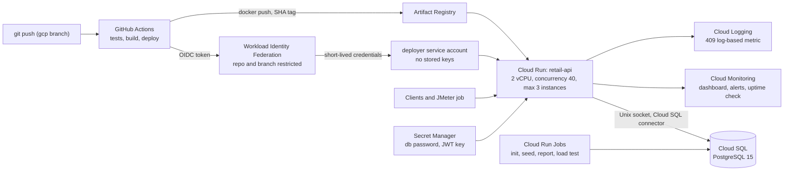

| Layer | Choice | Why |
|---|---|---|
| Compute | Cloud Run, 2 vCPU / 1 GiB, concurrency 40, max 3 instances, CPU boost | Stateless API, request-based scaling, revisions and traffic splitting |
| Database | Cloud SQL for PostgreSQL 15, `db-f1-micro`, zonal | Cheapest shared-core tier; `max_connections` measured at 25 |
| Images | Artifact Registry, tagged with the git SHA, keep-last-5 cleanup policy | Immutable tags, every deployed revision maps to a commit |
| Secrets | Secret Manager (database password, JWT key, admin password) | Nothing sensitive in the repo or image |
| Identity | Runtime service account with Cloud SQL Client and per-secret Secret Accessor only | Least privilege |
| CI/CD | GitHub Actions + Workload Identity Federation | No long-lived service account keys |
| Observability | Cloud Monitoring dashboard, uptime check, 3 alert policies, log-based metric | Golden signals plus the pool limit |

## Measured results (details and run settings in [RESULTS.md](RESULTS.md))

Load generator: Apache JMeter in a Cloud Run Job in the same region, 200 concurrent users, 5,000 requests, all requests HTTP 200 (stock topped up first), against a `db-f1-micro` database.

| Scenario | Throughput | p50 | p95 | p99 | Errors |
|---|---|---|---|---|---|
| All requests buy the same item (hot row) | 106.5 req/s | 955 ms | 1,785 ms | 3,455 ms | 0 |
| Requests spread over 4 items | 276.3 req/s | 260 ms | 524 ms | 4,892 ms | 0 |

- **Correctness:** across 34,296 purchases on 4 items (including runs that returned 409), orders equalled stock removed on every item. No overselling and no lost writes.
- **Variance is large.** The same 1,000-request test gave 35 req/s once and 104 req/s on a repeat, and p99 tails of 3 to 5 seconds appeared in most runs and were not diagnosed. Read these as "measured on this setup", not as capacity guarantees.
- **Not measured:** a Minikube versus Cloud Run comparison with the same test. No such claim is made.

COLD_START_PLACEHOLDER

## Findings worth knowing

1. **A hot row caps throughput.** Spreading the same load over 4 rows gave about 2.6x the throughput and about 3.7x lower median latency. This is consistent with row-lock contention on the single hot row (not confirmed by inspecting lock waits).
2. **Connection pooling must fit the database limit.** Budget: `instances x workers x (pool_size + max_overflow) <= max_connections - reserved`. The deployed setting is 3 x 2 x 3 = 18 against 22 usable connections. A deliberate test with 10 + 10 per worker (up to 120) let only 22.6% of 2,000 requests succeed; Postgres answered `remaining connection slots are reserved` and `too many clients already`. The median stayed low (246 ms) while p95 reached about 21 seconds, so percentiles and error rate show the problem, not the median.
3. **`/healthz` does not work on Cloud Run.** Its front end reserves that path on public `*.run.app` URLs and answers 404 itself, so the liveness route is `/livez`.
4. **Import-time `create_all` races between workers.** Two Uvicorn workers creating tables at once crashed one with a duplicate-key error. Tables are now created by a separate script (`scripts/init_db.py`), run as a Cloud Run Job.
5. **Unpinned dependencies broke fresh builds.** SQLAlchemy 2.1 maps a bare `postgresql://` URL to the psycopg v3 driver while the project installs psycopg2. The URL is now pinned to `postgresql+psycopg2://` and `requirements.txt` has exact versions.
6. **Alerts work end to end.** The 5xx alert fired during the pool exhaustion test and recovered about 10 minutes later.

## Screenshots

### Load tests, hot row versus spread
| | |
|---|---|
| 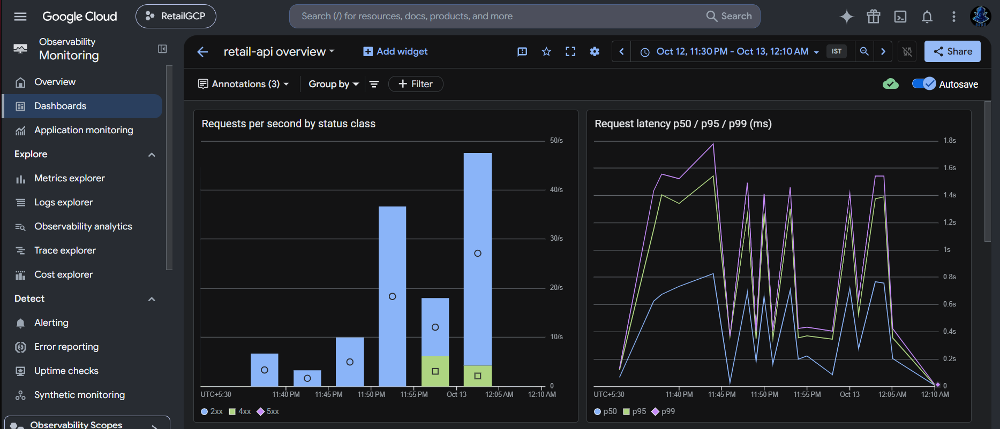 | 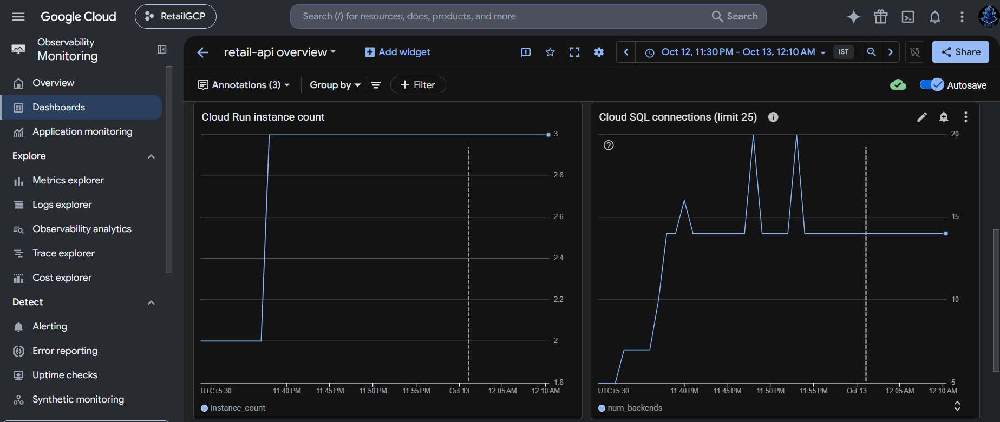 |
| Request rate by status class and latency percentiles | Cloud Run scaled to 3 instances; Cloud SQL connections under the limit of 25 |

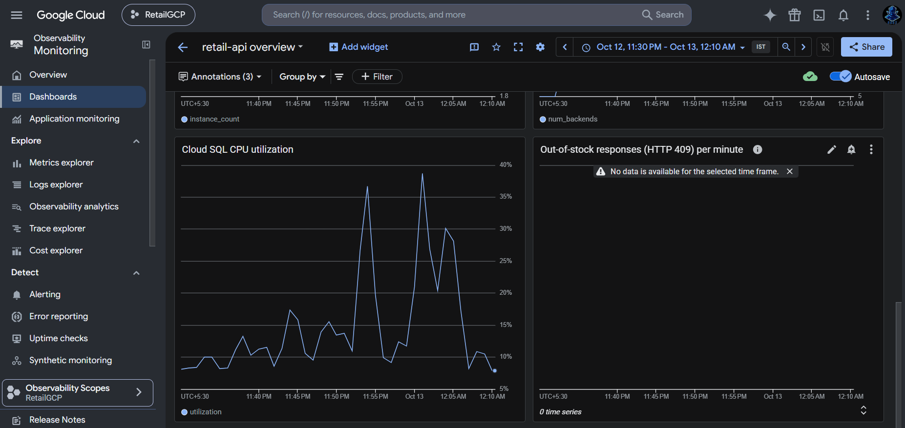

### Pool exhaustion test
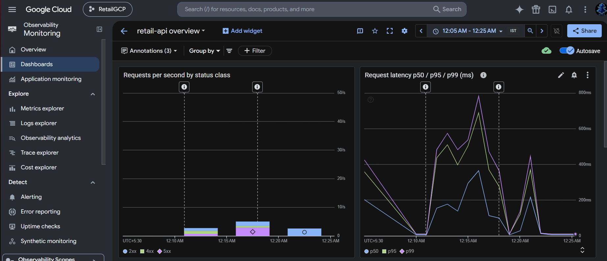

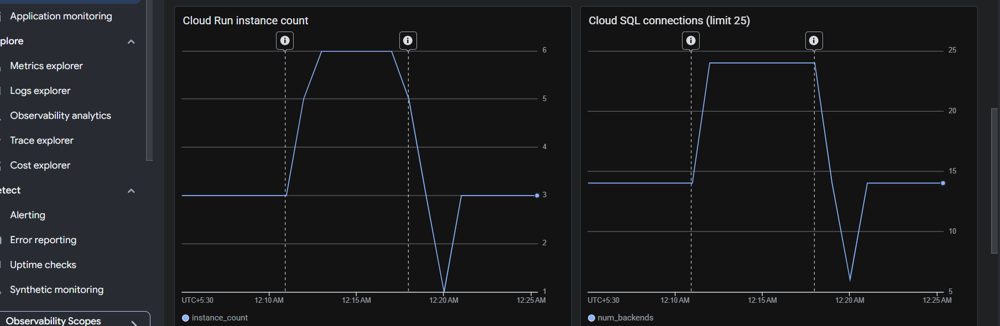

Cloud SQL connections reached 24 of 25 while instances rose to 6 during the rollout.

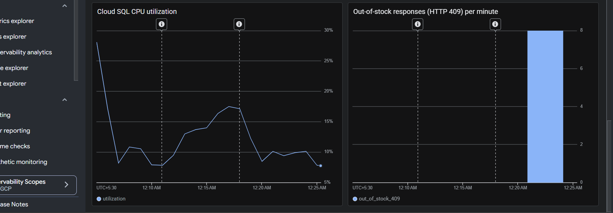

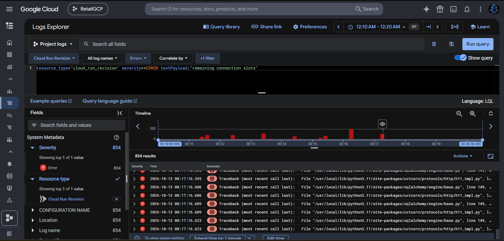

### Alerting
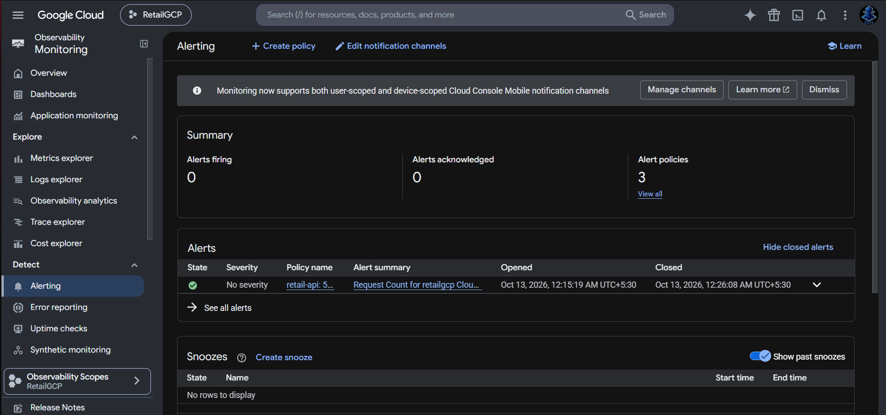

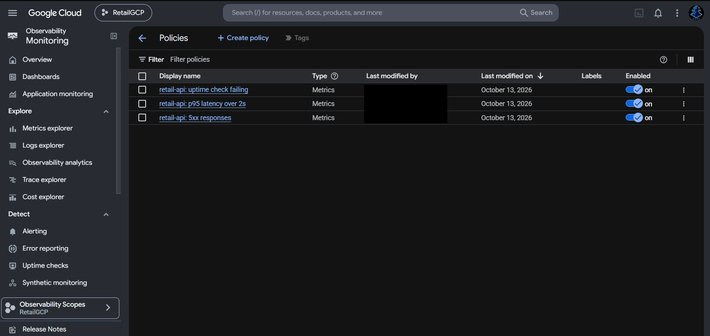

### Cloud Run
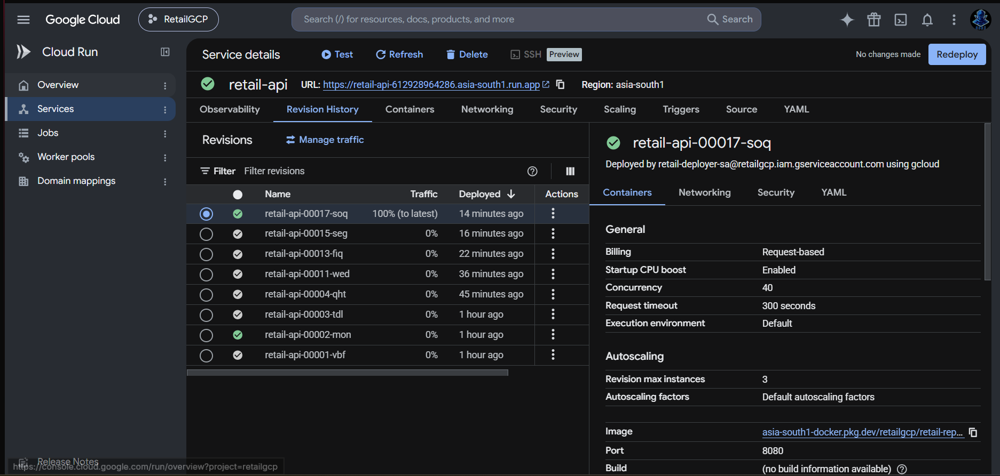

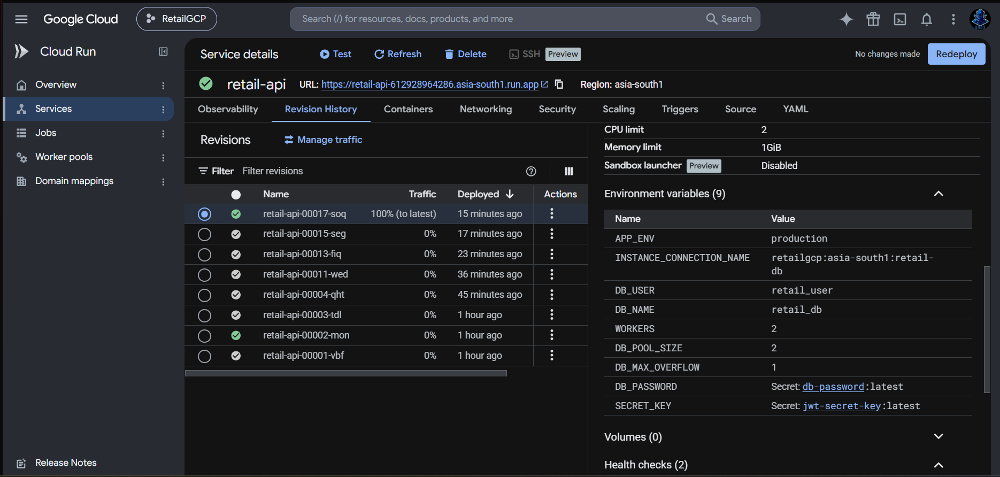

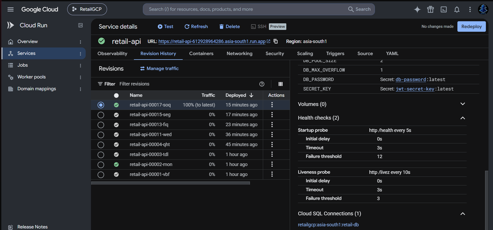

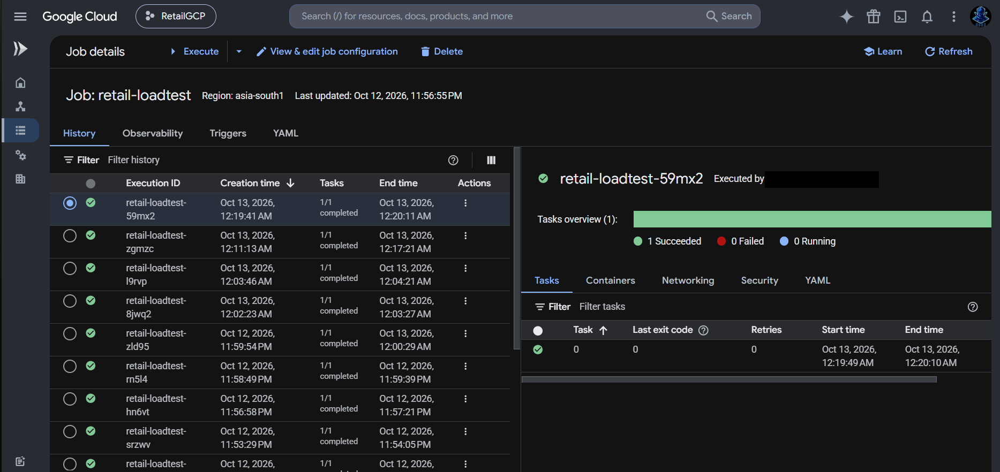

### Keyless CI/CD
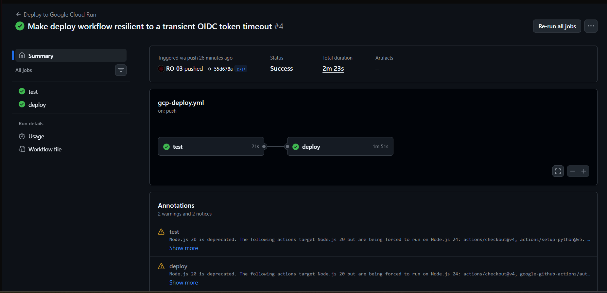

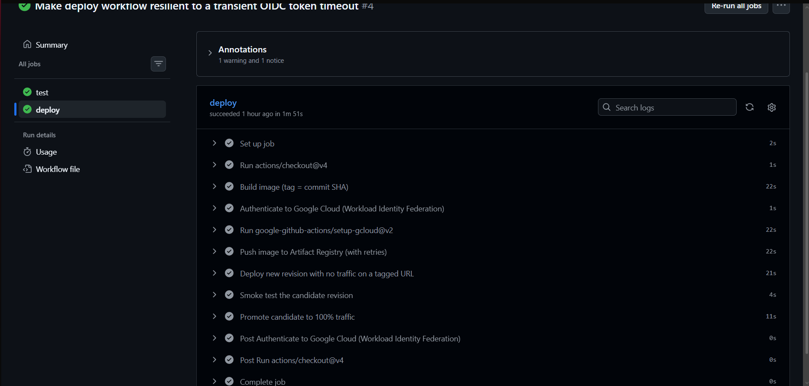

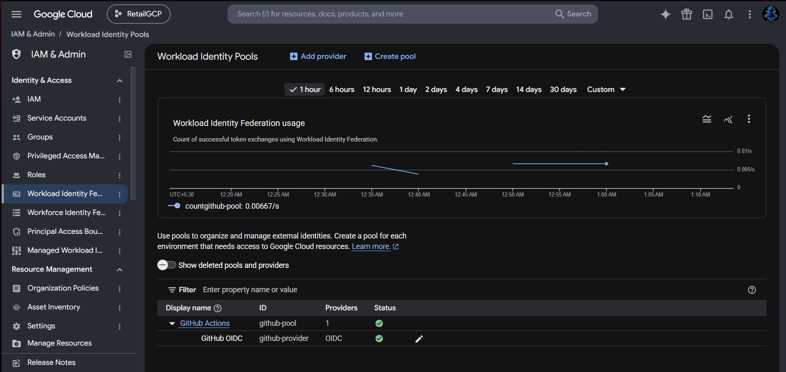

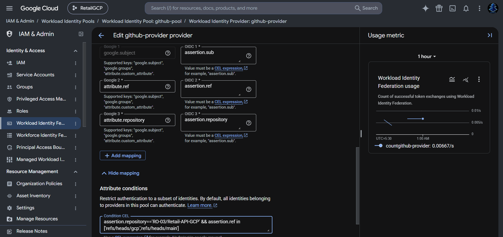

### Data, images and secrets
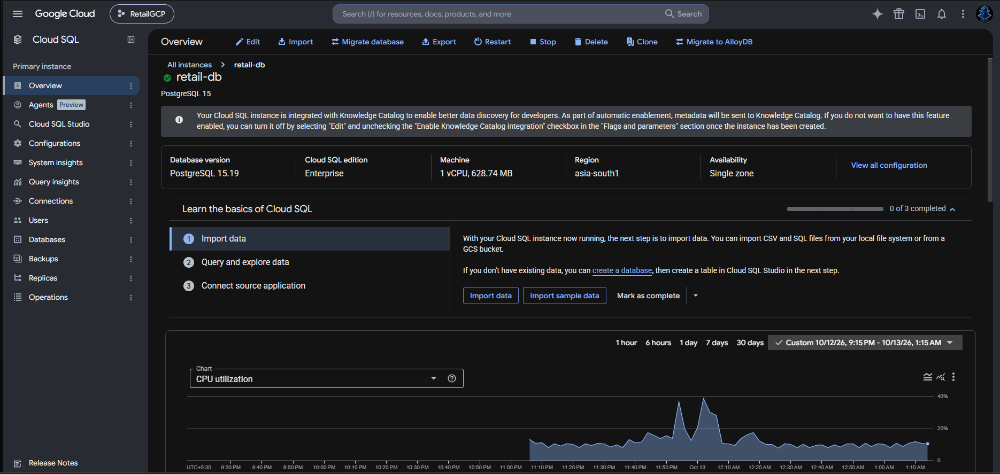

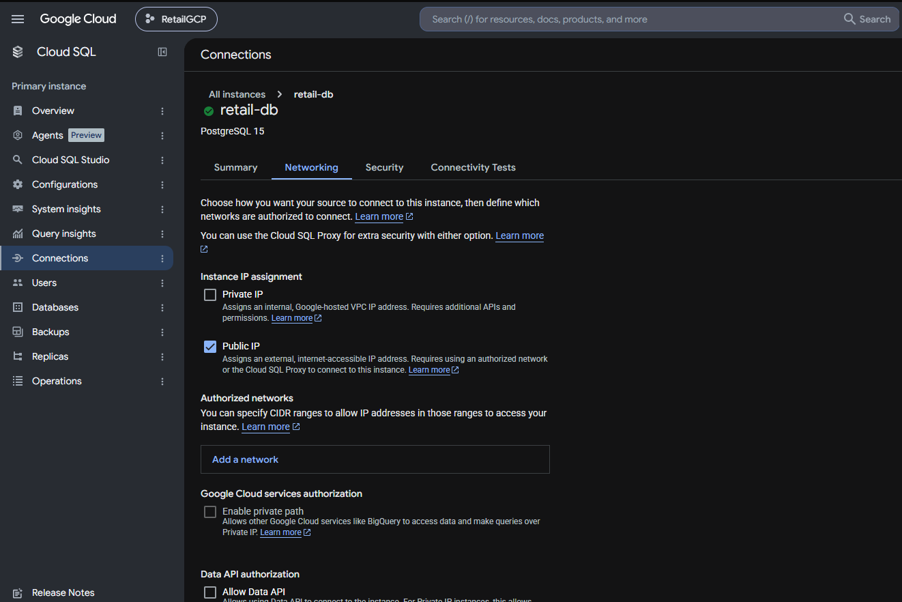

The instance keeps its default public IP but has no authorized networks, so the only access path is the Cloud SQL connector with IAM. Private IP was not set up.

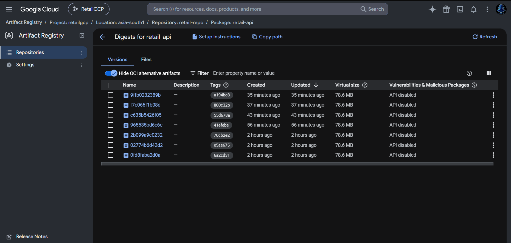

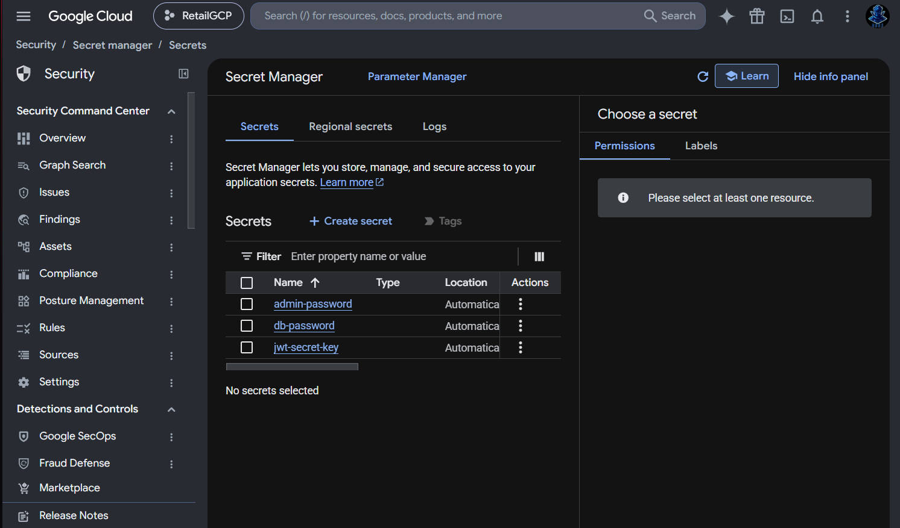

More screenshots are in [docs/Screenshots/](docs/Screenshots/).

## How it was built

The step-by-step plan, with what was verified and what went wrong at each phase, is in [IMPLEMENTATION_PLAN.md](IMPLEMENTATION_PLAN.md). Condensed, with placeholders:

```bash
# one-time: project, billing, APIs
gcloud config set project <PROJECT_ID>
gcloud config set run/region <REGION>
gcloud services enable run.googleapis.com artifactregistry.googleapis.com sqladmin.googleapis.com \
  secretmanager.googleapis.com cloudbuild.googleapis.com monitoring.googleapis.com logging.googleapis.com \
  iam.googleapis.com sts.googleapis.com iamcredentials.googleapis.com

# registry and image (tag = git SHA)
gcloud artifacts repositories create retail-repo --repository-format=docker --location=<REGION>
gcloud builds submit --tag <REGION>-docker.pkg.dev/<PROJECT_ID>/retail-repo/retail-api:$(git rev-parse --short HEAD) .

# runtime identity (least privilege)
gcloud iam service-accounts create retail-run-sa
gcloud projects add-iam-policy-binding <PROJECT_ID> --member=serviceAccount:retail-run-sa@<PROJECT_ID>.iam.gserviceaccount.com --role=roles/cloudsql.client
# plus roles/secretmanager.secretAccessor on each secret only

# database
gcloud sql instances create retail-db --database-version=POSTGRES_15 --edition=ENTERPRISE \
  --tier=db-f1-micro --region=<REGION> --availability-type=zonal --no-backup
gcloud sql databases create retail_db --instance=retail-db

# service (see the plan for the full flag list)
gcloud run deploy retail-api --image=<IMAGE> --service-account=retail-run-sa@<PROJECT_ID>.iam.gserviceaccount.com \
  --add-cloudsql-instances=<PROJECT_ID>:<REGION>:retail-db --cpu=2 --memory=1Gi --concurrency=40 \
  --max-instances=3 --cpu-boost --allow-unauthenticated \
  --set-env-vars=APP_ENV=production,INSTANCE_CONNECTION_NAME=<PROJECT_ID>:<REGION>:retail-db,DB_USER=retail_user,DB_NAME=retail_db,WORKERS=2,DB_POOL_SIZE=2,DB_MAX_OVERFLOW=1 \
  --set-secrets=DB_PASSWORD=db-password:latest,SECRET_KEY=jwt-secret-key:latest
```

Schema creation, admin creation, seeding and the database report run as Cloud Run Jobs with the same image (`python -m scripts.init_db`, `scripts.create_admin`, `scripts.seed_items`, `scripts.db_report`). Monitoring is defined as JSON in [monitoring/](monitoring/); the load generator image is in [loadtest/](loadtest/).

## Repository layout

| Path | Contents |
|---|---|
| `app/` | FastAPI app (controllers, models, services, views) |
| `scripts/` | `init_db`, `create_admin`, `seed_items`, `db_report` |
| `tests/` | Pytest suite (20 tests, SQLite) and `summarize_results.py` for JMeter output |
| `batches.jmx` | JMeter test; parameters `host`, `port`, `protocol`, `items`, `threads`, `loops`, `ramp` |
| `loadtest/` | JMeter image for Cloud Run Jobs (summary computed in the container) |
| `monitoring/` | Dashboard, alert policies and notification channel as JSON |
| `.github/workflows/gcp-deploy.yml` | Keyless deploy: test, build, no-traffic deploy, smoke test, promote |
| `RESULTS.md` | Every measured run, with settings and consistency checks |
| `IMPLEMENTATION_PLAN.md` | Phase-by-phase plan with findings |
| `k8s/`, `docker-compose.yml` | Original Kubernetes and local Docker setup (still working) |

## Local development

```bash
pip install -r requirements.txt
DATABASE_URL=sqlite:///./test_retail.db python -m pytest tests/test_api.py -v   # unit tests
docker compose up --build        # API on :8000 with Postgres (sets AUTO_CREATE_TABLES=1)
```

## Limits and honest notes

- Single region, small instance sizes, one run per configuration for most experiments and large run-to-run variance.
- The pipeline's first runs failed twice for fixable reasons (a `pytest` import path, and a transient identity-token timeout), documented in the plan. There is no performance gate in the pipeline, because the measured variance would make a throughput gate flaky.
- The old self-hosted-runner Minikube workflow (`deploy.yml`) is kept in the repo but disabled.
- Cost control: Cloud SQL is the main cost, so it exists only for the testing window. Budget alerts only notify and do not cap spending.
